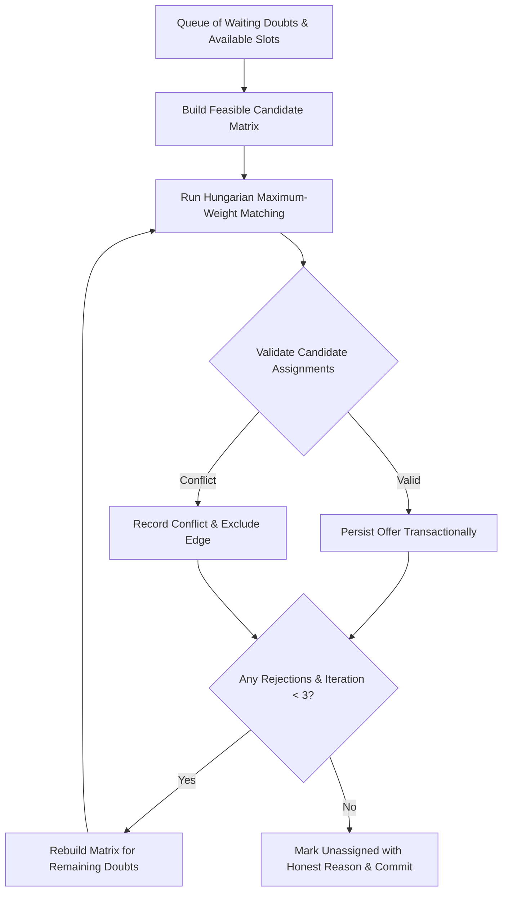
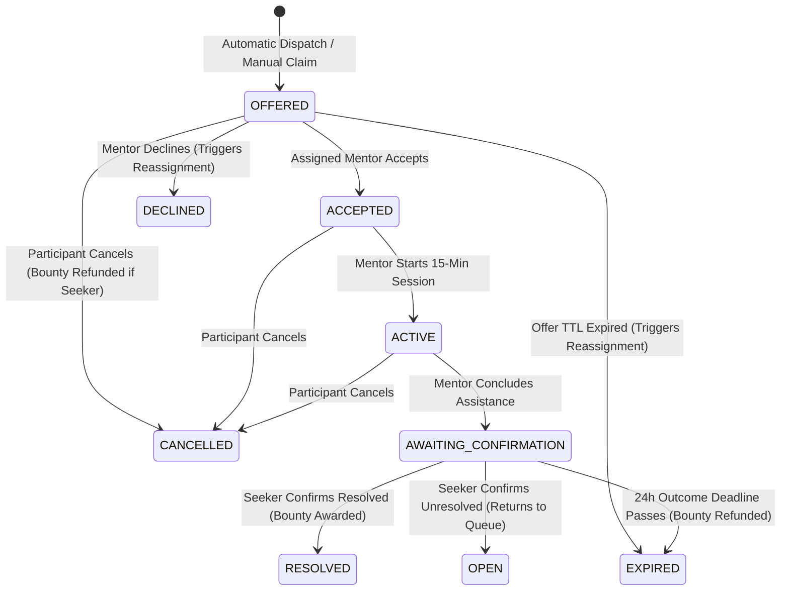

# TRIAGE15 — SYSTEM ARCHITECTURE

## 1. Overview & Stack Selection

Triage15 is an autonomous peer-to-peer micro-skill and doubt bounty board designed for college campuses. It matches technical doubt requests to available peer mentors within 15-minute grid intervals using deterministic maximum-weight bipartite optimization.

The optional ML stage now suggests eight existing technical tags from title/description using a locally trained TF-IDF + One-vs-Rest Linear SVM. Students explicitly accept or edit tags before the existing doubt API and Hungarian workflow. `/api/ml/*` is read-only and returns unavailable safely when disabled or missing. SQLite, eligibility, utility weights and the single-process dispatch coordinator are unchanged. See [ML architecture](ML_ARCHITECTURE.md) for training, mathematical explanations, measured evaluation and reproduction commands.

### Core Stack
- **Backend:** FastAPI (Python 3.14 / 3.12+), Pydantic v2 for strict schema validation.
- **Persistence:** SQLite in Write-Ahead Logging (`WAL`) mode with `foreign_keys=ON` and `busy_timeout=15000`.
- **ORM & Concurrency:** SQLAlchemy 2.0 with transactional write serialization via `BEGIN IMMEDIATE`.
- **Matching Engine:** Pure-Python Rectangular Hungarian algorithm (Kuhn-Munkres with potential-based augmentation) compared against a shared-matrix Greedy baseline.
- **Accounting:** Auditable integer virtual reputation point ledger (`PointLedger`) with unique settlement keys.
- **Frontend:** React 19, TypeScript, and Vite. Native responsive CSS with zero heavy third-party UI bloat, structured for clean visual redesign.

```mermaid
flowchart TD
    subgraph Client ["Frontend (React + TypeScript + Vite)"]
        UI[Modular Interface]
        Timer[Authoritative Countdown Timer]
        Chat[Live Workspace Chat]
        Poll[Reactive Polling Hook (2.5s - 4s)]
    end

    subgraph API ["FastAPI REST Gateway"]
        Auth[Demo Identity & Ownership Check]
        Validation[Pydantic v2 Input Validation]
        Routes[REST API Endpoints]
        Coord[Dispatch Coordinator]
    end

    subgraph Engine ["Optimization & Accounting Core"]
        Matcher[Rectangular Hungarian Engine]
        Greedy[Greedy Baseline Engine]
        Recovery[Iterative Conflict Recovery]
        LedgerSvc[Bounty Ledger Service]
        ReserveSvc[Session Reservation Service]
    end

    subgraph Storage ["SQLite (WAL Mode, BEGIN IMMEDIATE)"]
        Tables[(Relational Tables)]
        Indexes[Partial Unique Indexes]
        Ledger[(Point Ledger)]
    end

    UI -->|Fetch /api via Proxy| Routes
    Timer -->|Syncs with server_time| Routes
    Chat -->|Polls & posts messages| Routes
    Poll -->|Background refresh| Routes
    Routes --> Auth --> Validation
    Validation --> ReserveSvc & LedgerSvc & Coord
    Coord --> Matcher & Greedy --> Recovery
    Recovery --> ReserveSvc
    ReserveSvc --> Tables & Indexes
    LedgerSvc --> Ledger
```

---

## 2. Dispatch Coordinator & Matching Engine

### Centralized Dispatch Coordinator (`backend/app/main.py`)
Automatic matching is orchestrated by an in-process serialized dispatch coordinator (`DispatchCoordinator`). It eliminates manual button-pressing in production while preserving explicit dispatch endpoints (`POST /api/dispatch/run`) for benchmarks, debugging, and judge demonstration.

Automatic matching is triggered after:
1. New doubt submission (`POST /api/doubts` with `X-Auto-Dispatch: true`).
2. Eligible doubt edits (`PATCH /api/doubts/{id}`).
3. Mentor availability modifications (`POST` / `DELETE /api/students/{id}/availability`).
4. Mentor opt-in status changes (`PUT /api/students/{id}/profile`).
5. Mentor offer decline (`POST /api/sessions/{id}/decline`).
6. Offer expiration sweeps (background task running every 10s).
7. Session cancellation.

### Collective Bipartite Optimization (`backend/app/services.py` & `algorithms.py`)
Instead of matching doubts one-by-one (first-come first-served greedy allocation), the matching engine considers the entire queue of waiting requests collectively:
1. Collects all `OPEN` and `UNMATCHED` doubts in stable chronological order.
2. Expands active mentor availability into discrete 15-minute grid slots (`start % 900 == 0`, `end == start + 900`).
3. Evaluates hard feasibility constraints (domain match, skill tag intersection, mentor opt-in, non-self-assignment, time feasibility, participant busy checks).
4. Computes multi-factor suitability (0–100) and urgency-weighted utility for all feasible candidate pairs.
5. Injects zero-cost dummy columns for every request to guarantee that prohibited edges (`1e12` penalty) are never selected.
6. Executes the rectangular Kuhn-Munkres maximum-weight algorithm to maximize global total utility across the campus.

---

## 3. Allocation Conflict Recovery (P1.1)

While the Hungarian algorithm finds the mathematically optimal assignment on the candidate bipartite graph, complex cross-role scheduling constraints (e.g., a student who is simultaneously a mentor in one session and a help-seeker in another during the same time window) can create conflicts when multiple assignments are persisted.

Triage15 implements **Bounded Iterative Conflict Recovery**:
1. Run initial Kuhn-Munkres matching on the candidate matrix.
2. Validate each selected assignment against current database state.
3. Persist valid assignments transactionally inside SQLite.
4. Detect rejected assignments and record the specific conflict reasons.
5. If rejections occur, exclude the conflicting edges and consumed resources, rebuild the candidate matrix for remaining unmatched requests, and re-run Hungarian matching.
6. Repeat up to a configurable limit (`max_recovery_iterations = 3`).
7. Record detailed metrics (`solver_selected`, `persisted`, `rejections`, `recovery_iterations`, `recovered_assignments`).



---

## 4. Virtual Bounty & Reputation Ledger (P0.1)

To fulfill the bounty-board requirement without introducing real-money financial complexity, Triage15 implements an auditable **Point Ledger** (`PointLedger`):
- **Integer Storage:** Point balances and transactions are strictly integer (`points_balance: int`). Floating-point arithmetic is prohibited.
- **Database-Level Constraint:** `students` table enforces `CheckConstraint('points_balance >= 0')`, making negative balances impossible even under race conditions.
- **Transaction Types:**
  - `INITIAL_GRANT`: Demo account initial allocation (100–150 points).
  - `BOUNTY_RESERVED`: Points deducted from seeker balance upon doubt creation into reserved status.
  - `BOUNTY_AWARDED`: Points transferred to mentor upon requester's confirmed resolution.
  - `BOUNTY_REFUNDED`: Points returned to seeker if doubt is cancelled or expires.
  - `BOUNTY_ADJUSTED`: Points balance adjusted when seeker edits an open doubt's bounty.
- **Settlement Idempotency:** Every transaction records a unique `reference_id` (e.g., `reserve:{doubt_id}`, `award:{session_id}`, `refund:{doubt_id}`). SQLite's `UNIQUE` index constraint prevents duplicate rewards or refunds.

---

## 5. Live Session Workspace & Authoritative Timer (P0.2 & P0.3)

### Workspace Architecture
When a session is accepted, participants interact through a dedicated live workspace:
- **Bidirectional Messaging:** Messages (`SessionMessage`) are persisted in SQLite, tied to `session_id` and `sender_id`.
- **Access Control:** The backend enforces that only `session.mentor_id` and `doubt.requester_id` can read or post messages. Unrelated students receive `403 Forbidden`.
- **Safe Content Rendering:** User messages and code snippets are escaped and rendered safely via pre/code elements without raw HTML injection.
- **Incremental Polling:** Frontend polls `/api/sessions/{id}/messages` every 2.5 seconds using cursor/incremental polling (`since_id`).

### Authoritative 15-Minute Timer
- Timestamps (`start`, `end`, `actual_started_at`, `mentor_completed_at`, `outcome_deadline`) are stored authoritatively on the server.
- The client countdown derives strictly from `active_seconds_remaining` and `server_time`. Refreshing the browser or changing client system clocks cannot reset or manipulate the session timer.
- **Judge Demo Acceleration:** An explicit demo endpoint (`POST /api/sessions/{id}/accelerate`) enables hackathon judges to evaluate the full session lifecycle on an accelerated 30-second clock without waiting 15 minutes.

---

## 6. Complete Session Lifecycle



---

## 7. Concurrency & Integrity Guarantees

1. **Write Serialization:** Every state-modifying database transaction executes inside a `with transaction() as db:` block that issues `BEGIN IMMEDIATE` on SQLite, obtaining an exclusive write reservation before reading booking status.
2. **Double-Booking Protection:** Partial unique index `uq_active_mentor_slot` prevents any mentor from being scheduled twice in the same 15-minute slot across `OFFERED`, `ACCEPTED`, `ACTIVE`, and `AWAITING_CONFIRMATION` states.
3. **Simultaneous Claim Protection:** Partial unique index `uq_active_doubt` guarantees that if two mentors attempt to claim the same open doubt simultaneously, exactly one succeeds (200 OK) and the second receives `409 Conflict`.
4. **No Double-Settlement:** Unique index on `point_ledger.reference_id` guarantees that repeated clicks on resolution confirmation cannot award points twice.
