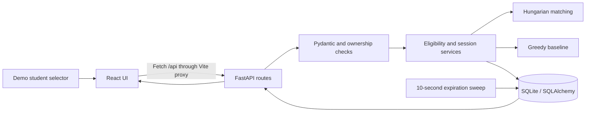
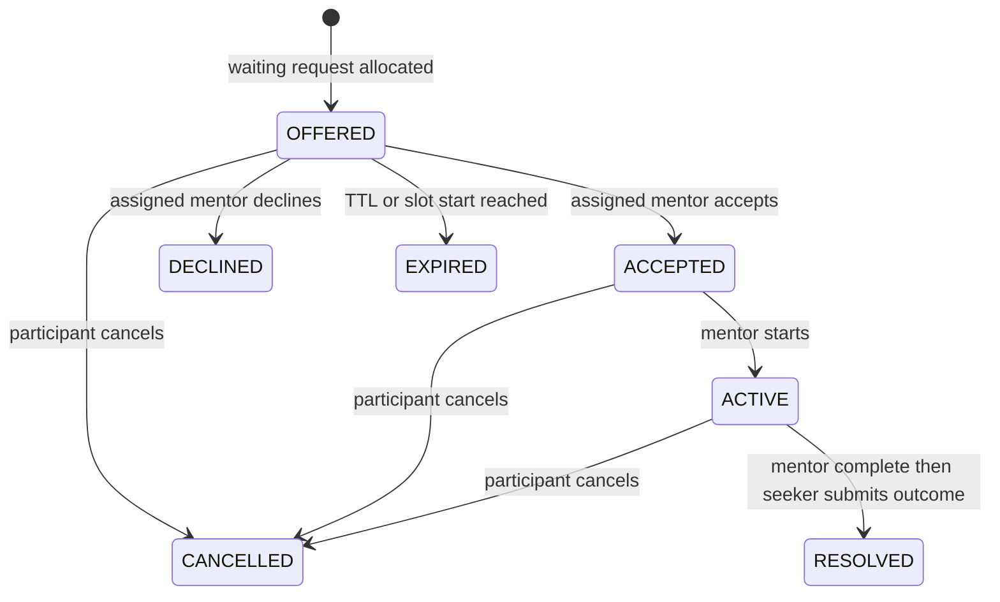

# Architecture

The repository was empty. The implementation uses the requested local stack without external services. `backend/app/main.py` holds REST routes and ownership/state checks; `schemas.py` validates inputs, `models.py` defines relational storage, `services.py` builds eligible edges and books offers, and `algorithms.py` implements independent allocation solvers. `seed.py` initializes reproducible synthetic examples relative to the current clock.

## Request and dispatch lifecycle

A selected synthetic identity is sent as `X-Demo-Student-ID`. Creating a doubt validates the domain, skill tags, title, description, urgency and optional timezone-qualified window. It inserts the request and normalized skill rows in one transaction. Read responses serialize timestamps to UTC ISO strings; React formats them as Asia/Kolkata.

Dispatch acquires SQLite's write reservation with `BEGIN IMMEDIATE` before reading state. It releases expired offers, collects OPEN/UNMATCHED requests, rounds available windows inward to the common 15-minute grid, builds eligibility/scoring matrices, runs both algorithms on those same matrices, and final-validates the optimized pairs before inserting OFFERED sessions. Every inserted offer reserves its slot immediately. The run stores snapshots, comparisons, unassigned reasons and rejected final conflicts.

All database-backed routes currently use the same serialized transaction wrapper, including reads that expire offers. This deliberately trades throughput for simple consistent local behavior. Foreign keys and unique indexes independently protect referential and slot integrity. An integrity conflict returns 409; unavailable/locked database operations return 503 without exposing SQL.

## Session lifecycle

OPEN is a request state, not a persisted session state. `RESOLVED` closes the session workflow; the separate `resolved` boolean records whether the problem was actually solved. A negative outcome reopens the doubt. Decline, expiry and cancellation also release the slot and reopen the request. Cancelling the doubt itself closes it as CANCELLED. A resolved request cannot be cancelled or edited.

The mentor's complete action sets a flag without incrementing a counter. Only the requester can store the final outcome and unique feedback. Metrics and smoothed reliability are computed from finalized session records, so retries cannot double-count. The local UI polls My sessions every ten seconds; other panels refresh after actions or navigation. No notification delivery service exists.

## Frontend responsibility

Logical components separate the doubt board, profiles/availability, assessments, sessions and benchmark. They render loading/empty/error/success states and invoke actual REST operations. Allocation and permissions are never decided by React. A global action wrapper disables the main action area while writes run. The identity menu is a demonstration control, never a security boundary.
