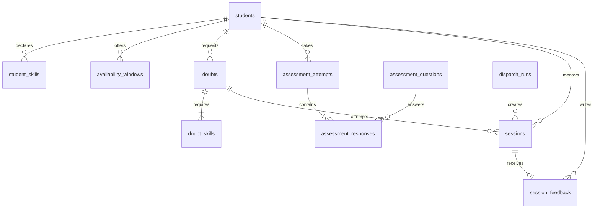

# Relational database

SQLite is sufficient for a local single-machine demonstration: no server setup, transactional persistence, indexes and foreign keys. SQLAlchemy 2.x maps records and parameterizes queries. Every connection enables foreign keys, WAL and a 15-second busy timeout. Application database transactions acquire `BEGIN IMMEDIATE` before reading booking state; this serializes competing writes.

All IDs are text UUIDs by default. Synthetic seed IDs and question IDs are stable human-readable text in the same identifier columns. All time fields store integer UTC epoch seconds. REST responses use timezone-qualified ISO strings. Profile skill level and student ratings have different meanings and storage.

| Table | Important fields and relations |
|---|---|
| students | id PK; name (demo display); mentoring boolean; owns skills and availability relationships |
| student_skills | id; student_id FK/index; domain, tag, level (1–5); unique student/domain/tag |
| availability_windows | id; student_id FK/index; start/end; CHECK end > start |
| doubts | id; requester_id FK/index; title, description, indexed domain, urgency, created_at, preferred_start, deadline, indexed status; nullable assigned_session_id FK to current reservation; owns doubt skill rows |
| doubt_skills | id; doubt_id FK/index; tag; unique doubt/tag |
| assessment_questions | id; indexed domain, prompt, JSON options, correct option index, version; correct never serialized by question endpoint |
| assessment_attempts | id; student_id FK/index, domain, score (0–100), question_count, correct_count, created_at, version |
| assessment_responses | id; attempt_id FK/index, question_id FK, answer index; unique attempt/question |
| dispatch_runs | id; created_at; JSON result with matrix comparison, explanations, initial assignment snapshots and unassigned/rejection reasons |
| sessions | id; doubt_id and mentor_id FK/index; optional dispatch_run_id FK; start/end, state, offer_expires_at, mentor_completed, nullable resolved boolean, notes, JSON explanation snapshot |
| session_feedback | id; unique session_id FK; student_id FK; rating CHECK 1–5; notes |
| benchmark_runs | id; created_at; JSON actual benchmark output for 50 scenarios |

JSON stores variable-length MCQ options and immutable calculation/report snapshots. Relationships and searchable operational data remain normalized. Dispatch snapshots retain initial offer state; `/dispatch/runs/{id}/assignments` reads current sessions.

`benchmark_runs` is independent. `doubts.assigned_session_id` additionally points to the current session; the application maintains agreement with `sessions.doubt_id` transactionally. This circular relation is why reset disables foreign keys briefly while dropping all tables; normal operation never disables them.

## Booking constraints

Partial unique indexes apply only to states OFFERED, ACCEPTED and ACTIVE:

- `uq_active_doubt(doubt_id)` prevents multiple live offers for one request.
- `uq_active_mentor_slot(mentor_id,start)` prevents a mentor serving two requests in a grid slot.

Every session has CHECK `start % 900 = 0 AND end = start + 900`. Thus uniqueness by start also prevents partial overlap for this fixed duration. Arbitrary-duration scheduling would need a different constraint. Status and urgency checks constrain enumerations; request-window checks reject reversed bounds. Application checks additionally enforce profile eligibility, ownership, preferred start, deadline, actual availability and both participants' live bookings.

Feedback has a unique session ID. State validation, atomic writes and record-derived metrics prevent duplicate resolution. Finalized unresolved sessions count in the reliability denominator, but not its numerator. Mentor completion alone is not finalized history until the seeker reports an outcome. No independent reputation counters can drift.

## Scaling and migration

SQLite permits one writer at a time. Reads use the same transaction helper here, reducing concurrency further. Long dispatches hold the write reservation; this is appropriate only for a small local batch. There is no migration framework: initial tables are created automatically and the explicit reset recreates the demo.

For production use Alembic migrations and PostgreSQL. Add row-level request/resource locks with consistent lock ordering, keep partial unique request constraints, and use an exclusion constraint over participant time ranges (or normalized participant reservations) for general overlap protection. Revalidate under those locks; handle retries and deadlocks. Do not simply swap the connection string: the current transaction SQL and connection pragmas are SQLite-specific. Preload evidence and history, partition batches, introduce durable dispatch jobs, and benchmark with real concurrency before scaling to thousands of users.
