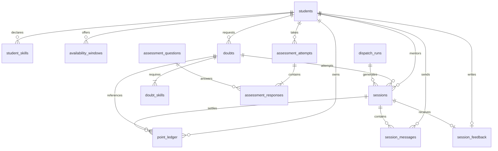

# TRIAGE15 — RELATIONAL DATABASE & STORAGE DESIGN

## 1. Overview & Engine Settings

Triage15 uses SQLite in Write-Ahead Logging (`WAL`) mode with foreign key enforcement and timeout handling configured on every connection:
- `PRAGMA foreign_keys = ON;` — Guarantees referential integrity across all relationships.
- `PRAGMA journal_mode = WAL;` — Permits concurrent readers alongside an active writer.
- `PRAGMA busy_timeout = 15000;` — Avoids immediate `database is locked` errors during bursts.
- `BEGIN IMMEDIATE` — Serializes read-validate-write transactions, preventing write-after-read race conditions in booking and ledger settlement.

---

## 2. Entity Relationship Diagram



---

## 3. Detailed Schema Specification

### 3.1 `students`
Primary identity records for participants (both seekers and mentors).
- `id` (String PK, UUID): Unique student identifier.
- `name` (String(80)): Student display name.
- `mentoring` (Boolean, default False): Opt-in flag for offering assistance.
- `points_balance` (Integer, default 100): Available virtual reputation points.
- **Constraints:** `CheckConstraint('points_balance >= 0')` — Guaranteed at database engine level.

### 3.2 `point_ledger` (P0.1 Bounty System)
Immutable audit trail for all reputation transactions.
- `id` (String PK, UUID): Ledger transaction identifier.
- `student_id` (String FK -> `students.id`, Indexed): Account affected.
- `amount` (Integer): Positive (credit) or negative (debit) point change.
- `transaction_type` (String): Enumeration constrained to:
  `'INITIAL_GRANT'`, `'BOUNTY_RESERVED'`, `'BOUNTY_AWARDED'`, `'BOUNTY_REFUNDED'`, `'BOUNTY_ADJUSTED'`.
- `doubt_id` (String FK -> `doubts.id`, Nullable, Indexed): Associated doubt.
- `session_id` (String FK -> `sessions.id`, Nullable, Indexed): Associated session.
- `reference_id` (String, Unique, Indexed): Settlement idempotency key (e.g., `grant:{id}`, `reserve:{doubt_id}`, `award:{session_id}`, `refund:{doubt_id}`).
- `balance_after` (Integer): Resulting balance snapshot for point auditability.
- `created_at` (Integer): UTC epoch timestamp.
- `notes` (String(255), Nullable): Audit explanation.

### 3.3 `doubts`
Student help requests.
- `id` (String PK, UUID): Doubt identifier.
- `requester_id` (String FK -> `students.id`, Indexed): Student requesting help.
- `title` (String): Concise question title (3–150 chars).
- `description` (String): Problem explanation (5–3000 chars).
- `domain` (String, Indexed): Academic discipline (e.g., `Python`, `SQL`, `JavaScript`).
- `urgency` (String): `'Urgent'`, `'Normal'`, or `'Flexible'`.
- `bounty` (Integer, default 0): Attached reputation reward.
- `created_at` (Integer): Submission UTC timestamp.
- `preferred_start` (Integer, Nullable): Earliest acceptable slot start.
- `deadline` (Integer, Nullable): Latest acceptable slot completion.
- `status` (String, Indexed): `'OPEN'`, `'MATCHED'`, `'IN_SESSION'`, `'AWAITING_CONFIRMATION'`, `'RESOLVED'`, `'UNMATCHED'`, `'CANCELLED'`.
- `assigned_session_id` (String FK -> `sessions.id`, Nullable): Active session pointer.
- **Constraints:**
  - `CheckConstraint('bounty >= 0')`
  - `CheckConstraint("status IN ('OPEN','MATCHED','IN_SESSION','AWAITING_CONFIRMATION','RESOLVED','UNMATCHED','CANCELLED')")`
  - `CheckConstraint("urgency IN ('Urgent','Normal','Flexible')")`
  - `CheckConstraint('deadline IS NULL OR preferred_start IS NULL OR deadline > preferred_start')`

### 3.4 `sessions`
15-minute scheduled or active peer assistance bookings.
- `id` (String PK, UUID): Session identifier.
- `doubt_id` (String FK -> `doubts.id`, Indexed): Associated doubt.
- `mentor_id` (String FK -> `students.id`, Indexed): Assigned mentor.
- `dispatch_run_id` (String FK -> `dispatch_runs.id`, Nullable): Generating dispatch run.
- `start` (Integer): Scheduled start epoch (must satisfy `start % 900 == 0`).
- `end` (Integer): Scheduled end epoch (must equal `start + 900`).
- `state` (String): `'OFFERED'`, `'ACCEPTED'`, `'ACTIVE'`, `'AWAITING_CONFIRMATION'`, `'RESOLVED'`, `'DECLINED'`, `'EXPIRED'`, `'CANCELLED'`.
- `offer_expires_at` (Integer): Timestamp after which offer expires.
- `accepted_at` (Integer, Nullable): When mentor accepted offer.
- `actual_started_at` (Integer, Nullable): When session started.
- `mentor_completed_at` (Integer, Nullable): When mentor concluded assistance.
- `outcome_deadline` (Integer, Nullable): 24-hour outcome confirmation window.
- `completed_at` (Integer, Nullable): When session finalized.
- `is_demo_accelerated` (Boolean, default False): 30-second judge demo clock flag.
- `mentor_completed` (Boolean, default False): Mentor completion indicator.
- `resolved` (Boolean, Nullable): Seeker-confirmed resolution outcome.
- `notes` (String, Nullable): Session notes.
- `explanation` (JSON): Suitability and allocation explanation snapshot.

### 3.5 `session_messages` (P0.2 Live Workspace)
Persistent bidirectional messaging records between session participants.
- `id` (String PK, UUID): Message identifier.
- `session_id` (String FK -> `sessions.id`, Indexed): Session room.
- `sender_id` (String FK -> `students.id`, Indexed): Participant sender.
- `content` (Text): Plain text or code snippet (1–4000 characters).
- `created_at` (Integer, Indexed): UTC epoch timestamp.
- **Constraints:** `CheckConstraint('length(content) > 0 AND length(content) <= 4000')`

### 3.6 Other Supporting Tables
- `student_skills`: Declared skills with levels (1–5). Unique on `(student_id, domain, tag)`.
- `availability_windows`: Mentor available ranges. Constraint: `end > start`.
- `doubt_skills`: Required skill tags. Unique on `(doubt_id, tag)`.
- `assessment_questions`: Domain question banks with prompt and JSON options.
- `assessment_attempts`: Scored submissions with versioning and timestamps.
- `assessment_responses`: Individual question answers tied to an attempt.
- `dispatch_runs`: Auditable dispatch execution snapshots with utility comparisons.
- `session_feedback`: Post-session 1–5 star ratings and qualitative notes.
- `benchmark_runs`: Persisted synthetic benchmark experiment records.

---

## 4. Database-Level Concurrency & Integrity Constraints

### Partial Unique Indexes for Double-Booking Prevention
```sql
CREATE UNIQUE INDEX uq_active_doubt 
ON sessions (doubt_id) 
WHERE state IN ('OFFERED', 'ACCEPTED', 'ACTIVE', 'AWAITING_CONFIRMATION');

CREATE UNIQUE INDEX uq_active_mentor_slot 
ON sessions (mentor_id, start) 
WHERE state IN ('OFFERED', 'ACCEPTED', 'ACTIVE', 'AWAITING_CONFIRMATION');
```
1. **Doubt Uniqueness:** A single doubt request can never have more than one live booking across the system simultaneously.
2. **Mentor Slot Uniqueness:** A mentor can never have two concurrent sessions overlapping in the same 15-minute grid interval.
3. **Ledger Idempotency:** The unique constraint on `point_ledger.reference_id` prevents duplicate bounty awards or refunds regardless of rapid user interactions or concurrent requests.
