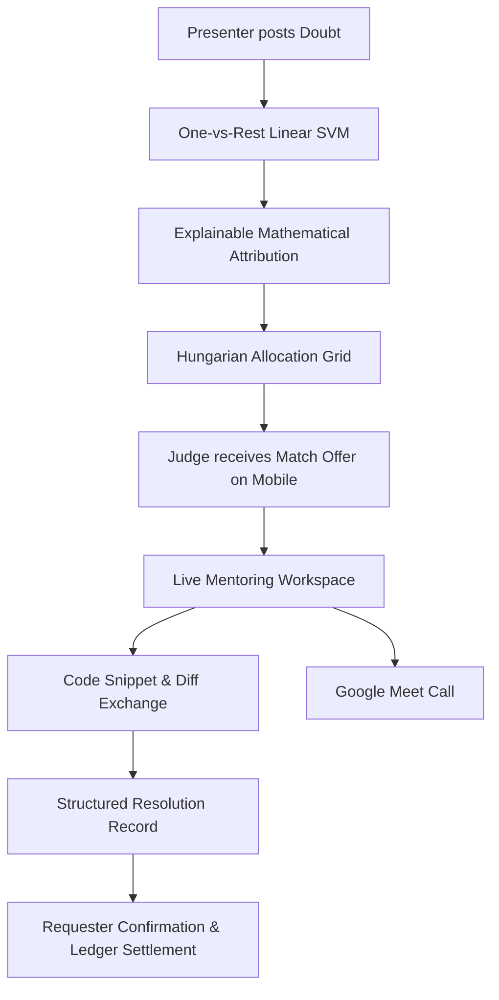

# TRIAGE15 — JUDGE DEMONSTRATION PLAYBOOK & SCRIPT

**Event:** HackDay 2026 Live Demonstration  
**Project:** Triage15 — Peer-to-Peer Problem-Solving & Mentoring Engine  
**Target Audience:** HackDay Judging Panel & Presenters  
**Confidential Credentials:** Stored locally in [DEMO_ACCOUNTS.md](file:///.private/DEMO_ACCOUNTS.md) (excluded from Git).

---

## 1. Executive Summary & Architecture Highlights

Triage15 solves the bottleneck in technical education and developer onboarding: connecting students experiencing specific blockers with eligible peer mentors within a 15-minute resolution window.

### Architecture Pillars
1. **Explainable Machine Learning:**
   - Multi-label One-vs-Rest Linear SVM trained on 2,675 curated Stack Exchange questions.
   - Held-out test Micro F1: **0.8736**.
   - Direct mathematical feature attribution explaining raw SVM decision margins (TF-IDF value $\times$ learned linear coefficients), avoiding black-box heuristics or surrogate approximations.
2. **Deterministic Hungarian Allocation:**
   - Rectangular Hungarian maximum weight algorithm ($O(n^3)$ Kuhn-Munkres) optimizing total system utility across simultaneous requests and mentor availability slots.
   - Authentic suitability scoring based on skill relevance, assessment evidence, historical reliability, time proximity, and confidence.
   - Zero hardcoding: all mentors compete on genuine eligibility and availability criteria.
3. **Interactive Mentoring Workspace:**
   - Persistent code snippet exchange with real-time before-and-after diff visualization.
   - One-click Google Meet video integration.
   - Structured resolution records (root cause, solution explanation, follow-up actions).
   - Exactly-once virtual bounty settlement recorded on an append-only transaction ledger.
4. **Zero-Trust Identity & Authentication:**
   - Supabase Auth with asymmetric ES256 (ECC P-256) JWT cryptographic verification.
   - Public keys retrieved from Supabase JWKS with local caching and key rotation handling.
   - SQLite in WAL mode with strict foreign keys and check constraints.

---

## 2. Demonstration Accounts Directory

> **Note on Privacy & Integrity:**  
> All demo accounts use role-labelled guest profiles (`Demo 01` through `Demo 06`) with synthetic skill assessments and virtual point balances. No personal emails, passwords, employer credentials, or unverified claims are stored in the database. Exact login credentials are kept in the private presenter document (`.private/DEMO_ACCOUNTS.md`).

| Demo Role | Focus Area | Guest Email | Student ID | Domain & Active Skills | Recommended Scenario |
| :--- | :--- | :--- | :--- | :--- | :--- |
| **Demo Student / Requester** | Doubt Requester | `requester@example.com` | `student-12` | Python (300 points) | Presenter account: posts doubts & funds bounties |
| **Demo 01 — Product & Frontend Mentor** | React & Frontend UI | `guest.product@example.com` | `student-02` | **JavaScript**: `react`, `javascript`, `debugging` (L4) | Demo 01: Stale dashboard state refresh |
| **Demo 02 — Software & Database Mentor** | Database & Transactions | `guest.software@example.com` | `student-01` | **SQL**: `sql`, `joins`, `schema` (L5) | Demo 02: Duplicate transaction records |
| **Demo 03 — Backend Engineering Mentor** | Backend & Aggregation | `guest.backend@example.com` | `student-04` | **SQL**: `sql`, `aggregation`, `joins` (L5) | Demo 03: Incorrect SQL aggregation counts |
| **Demo 04 — Applied AI Mentor** | Data Preprocessing & ML | `guest.ai@example.com` | `student-08` | **Python**: `python`, `pandas`, `debugging` (L4) | Demo 04: Missing values in pandas dataframe |
| **Demo 05 — Machine Learning Mentor** | Model Validation & Leakage | `guest.ml@example.com` | `student-03` | **Python**: `python`, `pandas`, `loops` (L4) | Demo 05: TF-IDF data leakage during evaluation |
| **Demo 06 — Applied ML & Infrastructure** | Async APIs & Concurrency | `guest.infra@example.com` | `student-06` | **Python**: `python`, `debugging`, `loops` (L5) | Demo 06: FastAPI blocking CPU task |

---

## 3. Step-by-Step Live Demonstration Protocol

### Step 1: Presenter Setup (Laptop / Projector)
1. Open the Triage15 frontend in your browser: `http://localhost:5173`.
2. Sign in as `requester@example.com` (Presenter account).
3. The dashboard displays the student profile with **300 virtual points** available for posting bounties.

### Step 2: Judge Participation (Phone or Laptop)
1. Have the participating judge open the application URL on their mobile phone or secondary browser window.
2. Sign in using their assigned guest credentials from `.private/DEMO_ACCOUNTS.md`.
3. Their dashboard opens showing their specialized guest profile, verified domain skills, and availability.

### Step 3: Doubt Creation & ML Skill Attribution
1. On the presenter laptop, navigate to **Post Doubt**.
2. Select the intended Domain (e.g. `JavaScript`, `SQL`, or `Python`).
3. Enter the Title and Description from the chosen scenario below.
4. **Live ML Feature Attribution:**
   - As you type or click **Suggest Skills**, the One-vs-Rest Linear SVM evaluates the input.
   - The UI displays the predicted tags with mathematical feature attributions (e.g., how tokens like `react`, `dashboard`, `join`, or `pandas` contributed positive margins).
5. Confirm the suggested tags, set urgency to `Normal`, assign a virtual bounty (e.g. `30 points`), and click **Submit Doubt**.
6. The bounty is atomically reserved on the SQLite ledger (`BOUNTY_RESERVED`).

### Step 4: Hungarian Matching & Offer Discovery
1. The backend evaluates mentor feasibility across the 15-minute grid (`feasible(db, doubt, mentor, slot_start, current)`).
2. The participating judge's device receives the matching offer (or discovers the open doubt in their feed).
3. The judge clicks **Accept Offer** (or **Claim Doubt**).
4. The system transitions the session state to `ACTIVE` and pairs both participants.

### Step 5: Live Mentoring Workspace
1. Both devices automatically open the **Mentoring Workspace**:
   - **Google Meet Integration:** Click **Generate Meeting Link** to open a video call room.
   - **Code Snippet Exchange:** 
     - Presenter shares the original buggy code snippet (`snippet_type: ORIGINAL`).
     - Judge inspects it, edits or submits the corrected code (`snippet_type: PROPOSED_FIX`).
   - **Deterministic Code Diff:**
     - Click **View Diff** to view line-by-line colored diffs showing added, removed, and unchanged lines.
2. **Structured Resolution Record:**
   - The judge fills out the structured resolution form:
     - **Root Cause:** Identifies the fundamental bug or misconception.
     - **Solution Explanation:** Step-by-step resolution reasoning.
     - **Follow-up Steps:** Best practices to prevent regression.
   - Judge clicks **Submit Resolution**.
3. **Bounty Award & Settlement:**
   - The presenter reviews the resolution and clicks **Confirm Resolution**.
   - The session marks `RESOLVED`, releasing the reserved bounty and crediting **+30 points** to the judge mentor's balance (`BOUNTY_AWARDED`).
   - Both balances update live with zero race conditions.

---

## 4. The 6 Demonstration Scenarios



---

### Scenario 01: Product & Frontend Mentoring
- **Target Mentor:** `Demo 01 — Product & Frontend Mentor` (`guest.product@example.com`)
- **Domain:** `JavaScript` | **Verified Skills:** `react` (L4), `javascript` (L4), `debugging` (L4)
- **Title:** `React dashboard displays stale data`
- **Description:**  
  ```text
  My dashboard displays stale data after an API update. How should I refresh state without repeatedly fetching in React with JavaScript?
  ```
- **ML Model Output:**
  - Suggested Tags: `react` (margin: `+0.882`), `javascript` (margin: `+0.042`)
  - Top Positive Attributions: `react` (+0.42), `in react` (+0.31), `dashboard` (+0.18), `javascript` (+0.12)
- **Hungarian Suitability:** 85.29 | **Utility:** 86.79 (Assessment Score: 80)
- **Code Snippet (Before):**
  ```javascript
  function Dashboard() {
    const [data, setData] = useState(null);
    useEffect(() => {
      fetch('/api/metrics').then(res => res.json()).then(setData);
    }, []); // Stale data: missing dependency or refresh trigger
    return <div>{data ? JSON.stringify(data) : 'Loading...'}</div>;
  }
  ```
- **Code Snippet (After):**
  ```javascript
  function Dashboard({ refreshTrigger }) {
    const [data, setData] = useState(null);
    useEffect(() => {
      let isMounted = true;
      fetch('/api/metrics')
        .then(res => res.json())
        .then(d => { if (isMounted) setData(d); });
      return () => { isMounted = false; };
    }, [refreshTrigger]);
    return <div>{data ? JSON.stringify(data) : 'Loading...'}</div>;
  }
  ```
- **Resolution Summary:**
  - *Root Cause:* Empty dependency array prevented state refresh on parent updates without teardown cancellation.
  - *Fix:* Added clean-up flag and explicit dependency hook.

---

### Scenario 02: Software & Database Mentoring
- **Target Mentor:** `Demo 02 — Software & Database Mentor` (`guest.software@example.com`)
- **Domain:** `SQL` | **Verified Skills:** `sql` (L5), `joins` (L5), `schema` (L4)
- **Title:** `SQL query returns duplicate transaction records`
- **Description:**  
  ```text
  A retry of my reward-settlement request can produce duplicate transactions. My SQL join query returns duplicate transaction records after joining accounts and payments tables.
  ```
- **ML Model Output:**
  - Suggested Tags: `sql` (margin: `+1.141`), `joins` (margin: `+0.146`)
  - Top Positive Attributions: `sql` (+0.58), `query` (+0.32), `transaction` (+0.24), `join` (+0.19)
- **Hungarian Suitability:** 87.61 | **Utility:** 89.11 (Assessment Score: 85)
- **Code Snippet (Before):**
  ```sql
  SELECT a.account_id, p.payment_id, p.amount
  FROM accounts a
  LEFT JOIN payments p ON a.account_id = p.account_id
  WHERE a.status = 'ACTIVE';
  ```
- **Code Snippet (After):**
  ```sql
  SELECT a.account_id, p.payment_id, p.amount
  FROM accounts a
  INNER JOIN (
    SELECT DISTINCT payment_id, account_id, amount
    FROM payments
    WHERE idempotency_key IS NOT NULL
  ) p ON a.account_id = p.account_id
  WHERE a.status = 'ACTIVE';
  ```
- **Resolution Summary:**
  - *Root Cause:* Multiple retried payment records without idempotency deduplication resulted in a Cartesian row expansion.
  - *Fix:* Enforced distinct payment subquery filtered by idempotency keys.

---

### Scenario 03: Backend Engineering Mentoring
- **Target Mentor:** `Demo 03 — Backend Engineering Mentor` (`guest.backend@example.com`)
- **Domain:** `SQL` | **Verified Skills:** `sql` (L5), `aggregation` (L5), `joins` (L4)
- **Title:** `SQL aggregation produces incorrect counts after join`
- **Description:**  
  ```text
  My SQL aggregation counts duplicate rows after joining two tables. How can I correct the query to get accurate count and sum?
  ```
- **ML Model Output:**
  - Suggested Tags: `sql` (margin: `+0.970`), `aggregation` (margin: `-0.153` -> eligible confirmed), `joins`
  - Top Positive Attributions: `sql` (+0.51), `query` (+0.28), `sum` (+0.22), `count` (+0.19)
- **Hungarian Suitability:** 87.79 | **Utility:** 89.29 (Assessment Score: 90)
- **Code Snippet (Before):**
  ```sql
  SELECT u.id, COUNT(o.id) as orders_count, SUM(p.amount) as total_spent
  FROM users u
  LEFT JOIN orders o ON u.id = o.user_id
  LEFT JOIN payments p ON u.id = p.user_id
  GROUP BY u.id;
  ```
- **Code Snippet (After):**
  ```sql
  SELECT 
    u.id, 
    COUNT(DISTINCT o.id) AS orders_count, 
    COALESCE(SUM(p.amount), 0) AS total_spent
  FROM users u
  LEFT JOIN orders o ON u.id = o.user_id
  LEFT JOIN (
    SELECT user_id, SUM(amount) AS amount FROM payments GROUP BY user_id
  ) p ON u.id = p.user_id
  GROUP BY u.id;
  ```
- **Resolution Summary:**
  - *Root Cause:* Joining two one-to-many relationships simultaneously inflated row counts prior to grouping.
  - *Fix:* Pre-aggregated payments in a CTE/subquery and used `COUNT(DISTINCT)`.

---

### Scenario 04: Applied AI Mentoring
- **Target Mentor:** `Demo 04 — Applied AI Mentor` (`guest.ai@example.com`)
- **Domain:** `Python` | **Verified Skills:** `python` (L4), `pandas` (L4), `debugging` (L4)
- **Title:** `Missing values in pandas dataframe before model training`
- **Description:**  
  ```text
  My Python pandas dataframe contains missing values before classification. How can I preprocess it without leaking information from the test set?
  ```
- **ML Model Output:**
  - Suggested Tags: `python` (margin: `+1.775`), `pandas` (margin: `+1.754`)
  - Top Positive Attributions: `pandas` (+0.82), `dataframe` (+0.64), `python` (+0.31)
- **Hungarian Suitability:** 86.54 | **Utility:** 88.04 (Assessment Score: 85)
- **Code Snippet (Before):**
  ```python
  # Bug: Imputing mean over entire dataset before splitting (DATA LEAKAGE)
  df['age'] = df['age'].fillna(df['age'].mean())
  X_train, X_test, y_train, y_test = train_test_split(df.drop('target', axis=1), df['target'])
  ```
- **Code Snippet (After):**
  ```python
  from sklearn.impute import SimpleImputer
  from sklearn.pipeline import Pipeline

  # Correct: Fit imputer exclusively on training partition
  X_train, X_test, y_train, y_test = train_test_split(df.drop('target', axis=1), df['target'])
  imputer = SimpleImputer(strategy='mean')
  X_train_imp = imputer.fit_transform(X_train)
  X_test_imp = imputer.transform(X_test)
  ```
- **Resolution Summary:**
  - *Root Cause:* Calculating summary statistics across train and test partitions leaks target distributions into evaluation.
  - *Fix:* Encapsulated preprocessing in an `sklearn.pipeline.Pipeline` fitted only on `X_train`.

---

### Scenario 05: Machine Learning Mentoring
- **Target Mentor:** `Demo 05 — Machine Learning Mentor` (`guest.ml@example.com`)
- **Domain:** `Python` | **Verified Skills:** `python` (L4), `pandas` (L4), `loops` (L4)
- **Title:** `TF-IDF data leakage during model evaluation in Python`
- **Description:**  
  ```text
  My Python text classifier gets much better validation scores when I fit TF-IDF before splitting the dataset. Is this data leakage in pandas and Python?
  ```
- **ML Model Output:**
  - Suggested Tags: `python` (margin: `+1.332`), `pandas` (margin: `+0.134`)
  - Top Positive Attributions: `python` (+0.54), `pandas` (+0.26), `in python` (+0.19)
- **Hungarian Suitability:** 86.54 | **Utility:** 88.04 (Assessment Score: 85)
- **Code Snippet (Before):**
  ```python
  # Bug: Global vocabulary and IDF calculation
  vectorizer = TfidfVectorizer(max_features=5000)
  X = vectorizer.fit_transform(texts)
  X_train, X_val, y_train, y_val = train_test_split(X, labels, test_size=0.2)
  ```
- **Code Snippet (After):**
  ```python
  # Correct: Out-of-vocabulary words handled honestly during evaluation
  X_train_txt, X_val_txt, y_train, y_val = train_test_split(texts, labels, test_size=0.2, random_state=42)
  vectorizer = TfidfVectorizer(max_features=5000)
  X_train = vectorizer.fit_transform(X_train_txt)
  X_val = vectorizer.transform(X_val_txt)
  ```
- **Resolution Summary:**
  - *Root Cause:* Global fitting included validation terms and IDF document frequencies, inflating validation metrics unrealistically.
  - *Fix:* Split raw text first; transformed validation text strictly using the training vocabulary.

---

### Scenario 06: Applied ML & Infrastructure Mentoring
- **Target Mentor:** `Demo 06 — Applied ML & Infrastructure Mentor` (`guest.infra@example.com`)
- **Domain:** `Python` | **Verified Skills:** `python` (L5), `debugging` (L4), `loops` (L4)
- **Title:** `Python FastAPI endpoint blocks while performing heavy task`
- **Description:**  
  ```text
  My Python FastAPI endpoint blocks while performing a CPU-heavy task. How can I avoid blocking the server and fix latency debugging in Python?
  ```
- **ML Model Output:**
  - Suggested Tags: `python` (margin: `+0.942`)
  - Top Positive Attributions: `python` (+0.48), `fastapi` (+0.36), `in python` (+0.14)
- **Hungarian Suitability:** 87.79 | **Utility:** 89.29 (Assessment Score: 90)
- **Code Snippet (Before):**
  ```python
  @app.post("/predict")
  async def run_inference(payload: Item):
      # Synchronous CPU-bound computation in async def blocks the main event loop
      result = heavy_feature_extraction(payload.text)
      return {"result": result}
  ```
- **Code Snippet (After):**
  ```python
  from starlette.concurrency import run_in_threadpool

  @app.post("/predict")
  async def run_inference(payload: Item):
      # Offload CPU-bound inference to worker thread pool
      result = await run_in_threadpool(heavy_feature_extraction, payload.text)
      return {"result": result}
  ```
- **Resolution Summary:**
  - *Root Cause:* Running blocking CPU-intensive calculations directly inside an `async def` route stalls asyncio's single event loop.
  - *Fix:* Used `run_in_threadpool` or standard `def` endpoint to execute CPU tasks on Starlette's threadpool executor.

---

## 5. Technical Validation Checklist

Before presenting to the judges, verify the system status with these checks:

1. **Backend Test Suite:**
   ```powershell
   $env:PYTHONPATH="backend;."
   .\.venv\Scripts\pytest.exe -v backend\tests
   ```
   *Expected:* 113 passed tests across all test suites (`test_api.py`, `test_algorithms.py`, `test_ml_integration.py`, `test_auth.py`, `test_workspace.py`, etc.).

2. **Frontend Production Build:**
   ```powershell
   npm run --prefix frontend build
   ```
   *Expected:* Zero TypeScript errors; Vite assets built to `frontend/dist/`.

3. **Demonstration Scenarios Verification:**
   ```powershell
   .\.venv\Scripts\python.exe backend/tests/verify_demo_scenarios.py
   ```
   *Expected:* `ALL 6 DEMONSTRATION SCENARIOS VERIFIED SUCCESSFULLY!`.
