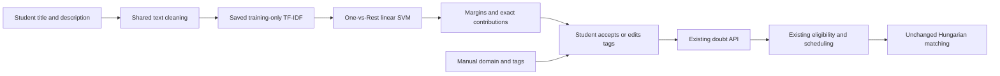

# Explainable skill suggestions and independent mentor optimization

The optional supervised classifier helps a student identify skill tags from a title and description. Historical question text is input and existing technical tags are targets; each record can have several targets. This is multi-label learning, not choosing a single class.



## Offline pipeline

`scripts/download_dataset.py::acquire` attempts Kaggle then caches official Stack Exchange API questions. The actual run used the API, not StackSample. `ml/preprocess.py::source_records` inspects schemas; `clean_html`, `normalize_tags`, `deduplicate`, and `prepare` clean, map, deduplicate and stratify. Answers, owners, tags, votes and URLs never enter text features.
TF-IDF multiplies sublinear term frequency (1+log count) by smoothed inverse document frequency, then L2-normalizes rows. Training-only vocabulary and document frequencies prevent leakage. Technical tokenization retains identifiers; sparse matrices avoid dense document-by-vocabulary allocations.
`ml/train.py::train` fits one independent binary classifier per label through OneVsRestClassifier. Multinomial NB models weighted term likelihoods with smoothing. Logistic Regression minimizes regularized logistic loss and estimates sigmoid probabilities. Linear SVM learns regularized separating hyperplanes using squared hinge loss. All use the same splits, labels and vectorizer.
Validation chooses thresholds and model. The held-out test is opened afterward. linear_svm was selected; validation micro F1 0.9078, test micro F1 0.8736. See [model card](MODEL_CARD.md) for every candidate and metric definition in `ml/evaluate.py::METRIC_DEFINITIONS`.

## Mathematical explanations

`ml/explain.py::parameters` extracts genuine learned coefficients or NB likelihood ratios. `explain_label` computes x_i*w_i for present sparse features. For LR z=b+sum(x_i*w_i), p=1/(1+exp(-z)). For SVM the same linear sum is a margin with no probability interpretation. For binary NB z=log P(y=1)-log P(y=0)+sum(x_i*(log P(feature_i|1)-log P(feature_i|0))). Global coefficients in `feature_importance.json` indicate association, not causation.

## Runtime and UI

`ml/predictor.py::SkillPredictor.load` runs once per process under a lock, checks packaged checksum and versions, and catches load failures. `predict` shares preprocessing and uses saved validation thresholds. No inference route writes to SQLite. `backend/app/ml_routes.py` exposes POST `/api/ml/predict-tags`, GET `/api/ml/status`, GET `/api/ml/metrics`, GET `/api/ml/model-info`. Input uses the existing title/description bounds and forbids extra fields. Metrics are saved results, never retraining.
`SkillSuggestions.tsx` uses an explicit button. Requests do not alter selected tags. Accepting a different-domain label explicitly replaces current domain/tags; the button says so. Existing checkboxes remove/add tags. Stale results are hidden when text changes. `DoubtBoard.tsx` submits only selected tags through its existing API and dispatch flow. `ModelEvaluation.tsx` displays measured comparisons, test results, feature weights and allocation reports.

## Allocation experiment

`ml/benchmark_real_workload.py::run_benchmark` creates 30 seeded scenarios from real question text and mapped tags. Profiles, skill declarations, availability, urgency and deadlines are simulated; multi-domain questions use their most represented mapped domain with deterministic tie-breaking. Both solvers see the identical first candidate matrix and equivalent initial isolated SQLite databases. Production `services.score`, `feasible`, and `dispatch` implement scoring and constraints; only a scoped test patch substitutes greedy for the solver. The production engine and weights are unchanged.
Shared-matrix utility: Hungarian 17521.0394, greedy 14901.9776. Integrated persisted utility: 16874.5787 versus 14641.7780. Persisted assignments: 235 versus 200. Invalid assignments and cross-role conflicts: zero in both. Final validation rejections and recovery are measured in the report; Hungarian is slower and does not guarantee every per-scenario metric improves. None of these numbers measures learning outcomes.

## Reproduce from repository root (PowerShell)

```powershell
uv pip install --python .venv/Scripts/python.exe -r ml/requirements-training.txt
.venv/Scripts/python.exe scripts/download_dataset.py
.venv/Scripts/python.exe -m ml.preprocess
.venv/Scripts/python.exe -m ml.train
.venv/Scripts/python.exe -m ml.benchmark_real_workload
.venv/Scripts/python.exe scripts/write_ml_docs.py
.venv/Scripts/python.exe -m pytest backend -q
npm --prefix frontend run build
$env:PYTHONPATH=".;backend"
.venv/Scripts/python.exe -m uvicorn app.main:app --host 127.0.0.1 --port 8000 --workers 1
```

Use Python >=3.12; pip can install the same requirements if uv is unavailable. On Unix use `.venv/bin/python` and `PYTHONPATH=.:backend`. `--api-only` skips Kaggle deliberately. Raw responses are reused; move an existing acquisition aside intentionally to acquire a new snapshot. Fixed cutoff/splits help reproducibility but live API deletions, retagging and edits can change later acquisitions. Preserve the ignored raw snapshot to reproduce the exact model, while honoring source licenses.

## Packaging and fallback

Docker adds `/app/ml` and `/app` to Python import resolution, and includes the ~1.85 MiB artifact and reports. Existing `/data` SQLite mount, port, single worker and coordinator remain. `.dockerignore` excludes data; optional Kaggle/stratification packages are training-only. Runtime pins sklearn/joblib/numpy/scipy. Run from repository root; README commands include it in PYTHONPATH. Set `ML_ENABLED=false` to disable; missing artifacts/dependencies safely disable suggestions, never manual tags. Redeploy/restart after replacing a controlled artifact because models load once.
